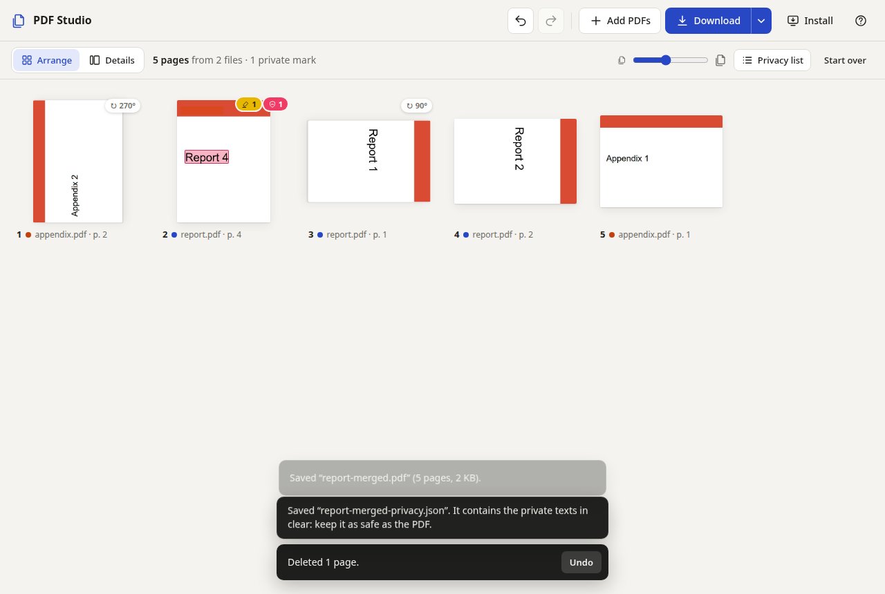
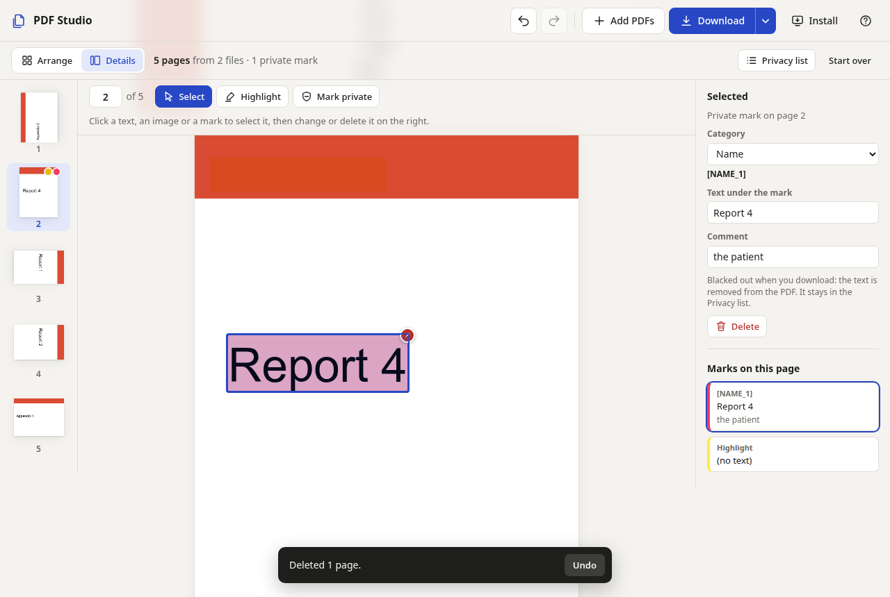

# PDF Studio

Rearrange, rotate and delete PDF pages in the browser, combine several PDFs into one, and
download the result. Everything happens on your device: no upload, no account, no server.
After the first visit it works offline, and it can be installed as an app.



## Features

- **Open** one or more PDFs: drop them anywhere on the page, or use *Add PDFs*.
- **Reorder** by dragging pages; select several pages to move them together.
- **Rotate** left or right, **delete** pages; every page shows where it comes from.
- **Details view**: one page large, with a strip of all pages to go through them (arrow keys,
  <kbd>D</kbd> / <kbd>G</kbd> switch between *Details* and *Arrange*).
- **Highlight** text in five colours, and **mark private parts** (names, addresses, contact data, numbers) by
  dragging over them; the download removes what is under a mark and blacks it out. See [Privacy marks](#privacy-marks).
- **Select objects** in the Details view and change or delete them: text, images, annotations
  the PDF came with, and your own marks. See [Changing and deleting objects](#changing-and-deleting-objects).
- **Page operations in the Details view** are in the strip on the left: drag a page to move it,
  hover for the bin, right-click to rotate or delete. Type a page number to jump there.
- **Undo and redo** for every change.
- **Download** the result as a new PDF. The arrow next to the button sets the file name and can
  protect the download with a password (AES-256).
- **Password-protected PDFs** open after you enter the password; files that only restrict
  permissions open right away.
- **Keyboard**: arrows to move around, <kbd>Ctrl</kbd>+arrows to move pages, <kbd>R</kbd> to
  rotate, <kbd>Del</kbd> to delete, <kbd>Ctrl</kbd>+<kbd>Z</kbd> to undo, <kbd>?</kbd> for all
  shortcuts.
- **Touch screens**: tap to select, press and hold to drag.
- **Install** as an app (button in the top bar): opens in its own window and works without
  internet. Chrome, Edge and Android show their install prompt; on Safari and Firefox the button
  explains the steps.
- **Version and updates**: the *Install* button (called *Version* once installed, *Update* when
  there is a newer one) shows which version runs and whether it is the latest, with *Update now*.
  A new version is fetched on every start, when the window comes back to the front and hourly;
  it is switched to right away while no PDF is open, otherwise when you say so.
- **Developer options** (a checkbox at the bottom of the <kbd>?</kbd> dialog): a selected object
  shows how it is written in the PDF: the operator in the content stream with its font or image
  object, the annotation dictionary, or the annotation a mark will become.
- Light and dark mode, phone to desktop.

## Privacy marks

In the Details view, pick *Mark private* (<kbd>P</kbd>), choose what it is (name, address, email /
phone, ID / number, other) and drag over the text. The marked text is read from the page; if there
is none (a scan) type it in on the right. A new or selected mark shows its fields there: colour or
category, text and a comment. The options of a tool (highlight colours, category) show in the bar
while that tool is in use.



What a download does with private marks is set under the arrow next to *Download*
(*Black out private marks*, on by default, remembered between visits):

- **Black out (default): the text is removed.** The result has a black box where each mark is, and
  what was under it is gone from the file, not covered: the characters are cut out of the text
  (the rest of the line stays where it was), the pixels are blanked in images (also in scans; only
  on the pages that have the mark, other pages keep the image), and the same is done inside groups
  of content. Annotations that touch a mark (comments, form fields, links) and the copies of text
  that tagged PDFs keep in their labels (`/ActualText`) are removed, and so is the page's small
  preview picture. The mark itself is not written to the PDF, because its text, comment and category
  would say what was removed. Highlights are kept, but a highlight over a blacked-out area does not
  keep the text it covered in its note. A black-out can't be undone in the downloaded file; the
  editor still has your marks and the original, so download again after a change.
- **Keep readable:** marks only annotate; nothing is removed. Each private mark is then a
  `/Highlight` annotation that every viewer shows and that pseudonymizing tools can read:
  - `/Contents`: the marked text, `/Subj`: `Privacy: Name` (or Address, …), `/NM`: a unique id,
  - `/QuadPoints`: one box per line of text,
  - `/PdfStudio`: `<< /Kind /Privacy /Category (name) /Placeholder ([NAME_1]) /Id (…) /Comment (…) >>`.

  A highlight's comment is its `/Contents`, so viewers show it as the note; for a private mark
  `/Contents` stays the marked text and the comment is in `/PdfStudio` and in the privacy list.
  Anyone who opens the file can read the text, and the download says so.

What can't be blacked out exactly is not left in silently:
- An image in a format that can't be edited here (JPEG 2000, JBIG2, CCITT fax, which scanners
  and archive tools use) that lies under a mark is removed as a whole, and the download says so.
  JPEG and the usual raw formats are blanked pixel by pixel; a JPEG is saved again (quality 92%).
- A page that can't be redacted reliably is an error, and nothing is saved, so a file that was
  meant to be redacted is never saved with the text still in it. That is a page whose content
  can't be read, or one with text in a font whose letter widths are only guessed (vertical
  writing, East Asian encodings other than Identity-H, a missing or damaged font): there a cut
  could miss letters.
- Invisible text under a mark (size 0, or in the hidden text layer of a scanned page) is removed
  like any other text.
- **Vector drawings** (lines, shapes, text that was turned into outlines, patterns) under a mark
  are covered by the black box but stay in the file. Check the result with a text extractor
  (for example `pdftotext`) if it matters.
- The document's metadata (title, author, subject, keywords) is taken from the first file and not
  looked at.

**In the privacy list** (`…-privacy.json`, the *Privacy list* button, works in both modes):

```json
{
  "format": "pdf-studio-privacy/1",
  "replacements": { "[NAME_1]": "Jane Doe", "[ADDRESS_1]": "Hauptstr. 1, Ulm" },
  "entries": [
    { "id": "m3", "page": 2, "category": "name", "text": "Jane Doe",
      "comment": "", "placeholder": "[NAME_1]", "rects": [[72, 640.5, 131.2, 652.5]] }
  ]
}
```

The same text in the same category always gets the same placeholder, so one person stays one
person across all pages. A tool replaces every `text` by its `placeholder` (pages and rects tell
where), and `replacements` turns the placeholders back into the originals later. Pages are
numbered as in the result, coordinates are PDF points with the origin at the bottom left. The
list contains the private texts in clear: keep it as safe as the original PDF. After a black-out
the list is the only place that still has them.

Pages deleted in the editor take their marks with them.

## Changing and deleting objects

In the Details view the *Select* tool (<kbd>S</kbd>) is active unless you pick another one. The
object under the pointer gets a dashed frame; a click selects it, dragging a rectangle selects
everything whose middle is inside, <kbd>Shift</kbd>-click adds to the selection. Clicking the
same spot again reaches what lies underneath (the text under a mark). The panel on the right
then offers what can be done: **change the text** of a text, and **delete** (<kbd>Del</kbd>).
Undo brings everything back.

- **Deleted text and images are really removed**, not covered: the page's content is rewritten
  without them, and the data of a deleted image leaves the file unless another page still shows
  it. The editor then draws the rewritten page, so what you see is what the download contains.
- **Changed text** replaces the old text, which is removed the same way. The new text is set in
  the standard font closest to the old one (Helvetica, Times or Courier, bold and italic kept),
  at the same place, size, direction and colour, so it can look a little different, and it is
  not fitted to the old width. Characters outside Western European text become "?".
- Text comes in the pieces the PDF stores it in. Depending on the program that made the PDF,
  one piece is a line, a word or sometimes a single letter; drag a rectangle to take several.
  The text after a deleted piece keeps its place.
- **Annotations** that were already in the PDF (comments, links, form fields, highlights) can be
  deleted the same way.
- Not possible yet: vector drawings (lines, shapes, charts), and single parts of a *group* (a
  form XObject, e.g. a placed logo or an imported page), which can only be deleted as a whole.
  The frame shows what a click will take.
- The font data stays in the file, so a deleted name leaves no text, but the letter shapes of
  an embedded font may remain.

## Privacy

- PDFs are read and written in the browser (pdf.js for the previews, pdf-lib for the result).
- The page's Content Security Policy blocks every request to another server, so files can't be
  sent anywhere even by mistake.
- Deleted pages are really gone. The result is a new file that contains only the kept pages,
  not the old pages as unused objects. Links between pages are cut before copying, so a link to a
  deleted page can't pull that page back in.

## Use it

It's a static site: any web server that serves the repository root works. Locally:

```bash
make run         # prints http://localhost:8000/ and the address for other devices
```

No `npm install` is needed for that. Other devices on the network can use the app, but over plain
`http://` browsers don't allow service workers, so offline mode and installing only work on
`localhost` or behind HTTPS.

Opening `index.html` directly from disk (`file://`) does not work, because browsers block ES
modules and web workers there.

To publish it, serve the repository root as it is, for example with GitHub Pages
(Settings → Pages → *Deploy from a branch*, `main`, `/ (root)`). All runtime files, including the
libraries in `vendor/`, are committed, so no build step is needed.

## Limitations

- **Certificate-protected PDFs** (public-key security) cannot be opened. Password protection
  and permission restrictions are removed when the file is opened.
- **Not carried over:** bookmarks (outline), links between pages, and the form structure. Form
  fields still look the same but can no longer be filled in. Title, author, subject and keywords
  come from the first page's file.
- Very large files (hundreds of MB) are limited by the browser's memory.

## Development

| Command | What it does |
|---|---|
| `make run` | Local server, also reachable from the local network; prints the URLs and rewrites `asset-manifest.js` when files change (`npm start`: this computer only) |
| `npm test` | Unit tests (page operations, PDF assembly, encryption, offline file list); the encryption tests use `qpdf` when it is installed |
| `npm run test:browser` | End-to-end test in headless Chrome, including offline; updates the screenshots in `docs/` |
| `npm run vendor` | Copies pdf.js and pdf-lib from `node_modules/` to `vendor/` (after updating them) |
| `npm run manifest` | Rewrites `asset-manifest.js` (the files the service worker caches) |
| `npm run icons` | Renders `icons/icon.svg` into the PNG icons |

The browser test and the icon script use the installed Google Chrome through Playwright. If
Chrome is somewhere else, set `CHROME=/path/to/chrome`; set `HEADED=1` to watch the test.

### How it fits together

| File | Role |
|---|---|
| `index.html`, `src/styles.css` | Page and styles |
| `src/app.js` | UI: page grid, selection, dragging, keyboard, toasts, upload, download |
| `src/model.js` | The page list as pure functions (insert, move, rotate, remove) plus undo history |
| `src/thumbnails.js` | Previews with pdf.js, rendered lazily and kept as small JPEGs |
| `src/pdf-worker.js`, `src/worker-client.js` | Web worker that parses uploads and builds the result |
| `src/assemble.js` | Builds the result with pdf-lib: copy, rotate, strip cross-page references, drop unused objects |
| `src/redact.js`, `src/image-codec.js` | Black-out of private marks: cuts characters and pixels out of the content; the codec reads and writes JPEG with the browser's canvas |
| `src/decrypt.js`, `src/encrypt.js` | Opening password-protected PDFs (RC4, AES-128, AES-256); password protection for the download (AES-256) |
| `src/crypto.js` | SHA-2, AES, MD5 and RC4 in plain JavaScript (Web Crypto is missing on plain `http://`) |
| `sw.js`, `asset-manifest.js` | Service worker: caches all files on install, serves them offline |
| `vendor/` | pdf.js and pdf-lib, copied by `npm run vendor` (versions in `vendor/VERSIONS.md`) |

After changing any file the app loads, run `npm run manifest` (or keep `make run` running) and
commit `asset-manifest.js` too; `npm test` fails if you forget. Browsers that already have the
app then get the new version and offer *Reload*.

## License

MIT, see [LICENSE](LICENSE). Bundled libraries: pdf.js (Apache-2.0) and pdf-lib (MIT); their
license files are in `vendor/`.
